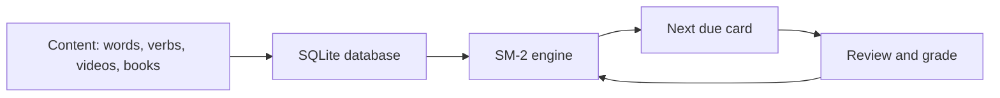

# Eñe

**A desktop app to learn Spanish with spaced repetition, from vocabulary to real spoken Spanish.**

Eñe applies the SM-2 spaced-repetition algorithm (the one behind Anki) to every part of language learning: words, verb conjugations, expressions, reading and listening. Each exercise is scheduled at the moment you are about to forget it.

## Features

- **Vocabulary**: about 6,000 Spanish words, filterable by theme and CEFR level, reviewed as flashcards or by typing the Spanish word.
- **Conjugation**: 1,227 verbs across every tense and person, with typed answers checked automatically and tenses that can be switched on or off.
- **Listening (dictation)**: add any YouTube video by URL or search. The app splits it into sentences using its Spanish captions, plays one sentence at a time, and checks what you type against the real transcript.
- **Shadowing**: plays a video sentence by sentence and pauses after each one so you can repeat it aloud.
- **Reading**: import EPUB books and read them with instant translation.
- **Progress tracking**: daily due cards, review history and statistics.

## How it works



- **One scheduling engine, several content types.** A single pure SM-2 engine schedules vocabulary, conjugation, listening, expressions and reading cards alike.
- **Content generated offline.** Node scripts build the vocabulary and conjugation datasets, which are bundled with the app and imported into SQLite on first launch.
- **Desktop architecture.** The interface is a React Native app exported for the web and packaged with Electron for Windows. The database and network calls run in Electron's main process and are reached through IPC, which keeps the interface sandboxed.

## Tech stack

- **App:** React Native (Expo), React, TypeScript (strict mode)
- **Desktop:** Electron, electron-builder
- **Data:** SQLite (`node:sqlite`)
- **Tests:** Jest
- **Reference implementation:** the SM-2 engine and review scheduler were first written as tested Swift packages (`Packages/`), which serve as the specification for the TypeScript version

## Run it

```bash
cd mobile
npm install
npm run desktop          # development mode
npm run desktop:package  # build the Windows installer
```

Run the tests:

```bash
cd mobile
npx jest --watchAll=false
```

## Project history

Eñe started as a native iOS app in Swift. Without a Mac to build it, I moved to React Native with Expo, then to an Electron desktop app for Windows. The design decisions behind each step are documented in [`docs/DECISIONS.md`](docs/DECISIONS.md).
